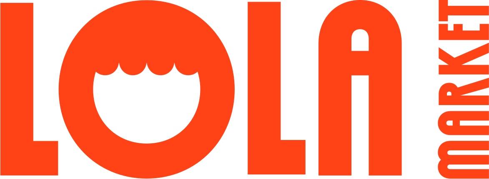

<p align="center">
  <a href="https://lola.market">
    
  </a>
</p>

<h1 align="center">Your things can do more.<br><sub>Now your AI agent can help.</sub></h1>

<p align="center">
  Connect your terminal and your AI agent to <a href="https://lola.market">LOLA Market</a>,<br>
  the community marketplace for renting, lending and selling things near you.
</p>

<p align="center">
  <a href="https://github.com/lola-market-team/lola-cli/actions/workflows/ci.yml"></a>
  <a href="https://www.npmjs.com/package/@lola-market/cli"></a>
  <a href="https://github.com/lola-market-team/lola-cli/blob/main/LICENSE"></a>
  <a href="https://modelcontextprotocol.io"></a>
</p>

---

Ask your assistant to find a drill nearby, list the camera you never use, or
answer a message about your listing. LOLA works with Claude, Cursor and any
other client that speaks the [Model Context Protocol](https://modelcontextprotocol.io).

## 🚀 Get started

### Hosted MCP: nothing to install

Add LOLA as a remote MCP server in any client that supports OAuth:

```
https://api.lola.market/lola-mcp
```

Your client opens a LOLA sign-in page, you approve, done.

### Local: `lola` and `lola-mcp`

For terminals, scripts, and MCP hosts that run local servers (Node.js 20+):

```sh
npm i -g @lola-market/cli
lola login                       # approve once in your browser
```

Then connect your agent:

```sh
claude mcp add lola -- lola-mcp  # Claude Code
```

```json
{
  "mcpServers": {
    "lola": { "command": "lola-mcp" }
  }
}
```

`lola-mcp` is a small bridge to the hosted server: it uses your `lola login`
session and offers exactly the tools your account has. Not logged in yet? Your
agent can call `lola_login` and hand you the link.

## 🧭 From the terminal

```sh
lola whoami                                   # who am I logged in as?
lola tools                                    # what can my account do?
lola call browse_search '{"q":"bohrmaschine"}'
lola call <tool> --file args.json             # arguments from a file
lola logout --server                          # sign out and revoke
```

## 🔒 Security

- **You approve every login** in your browser; the CLI never sees your
  password.
- **The server decides everything.** This client holds no secrets and no
  business logic. It forwards your requests to `api.lola.market`, which
  checks every permission.
- **Your session stays on your machine** in `~/.config/lola/credentials.json`
  (mode `0600`). `lola logout --server` deletes and revokes it.

Found a vulnerability? See [SECURITY.md](https://github.com/lola-market-team/lola-cli/blob/main/SECURITY.md), and please don't open
a public issue.

## ⚙️ Configuration

| Variable | Default | Purpose |
|---|---|---|
| `LOLA_BASE_URL` | `https://api.lola.market` | API origin (https only, except localhost) |
| `LOLA_CREDENTIALS_FILE` | `~/.config/lola/credentials.json` | Where the session is stored |

## 🤝 Contributing

Issues and pull requests are welcome.

```sh
git clone https://github.com/lola-market-team/lola-cli.git
cd lola-cli
npm install
npm run check        # build + tests
node dist/bin.js --help
```

See [CONTRIBUTING.md](https://github.com/lola-market-team/lola-cli/blob/main/CONTRIBUTING.md) and our
[Code of Conduct](https://github.com/lola-market-team/lola-cli/blob/main/CODE_OF_CONDUCT.md).

## 🧡 About LOLA

<a href="https://lola.market"></a>

[LOLA Market](https://lola.market) is built in Vienna, Austria, for
musicians, filmmakers, students, parents, clubs, neighbourhoods and
businesses: anyone who'd rather share what they have than let it gather
dust. Supported and recognised by aws (Austria Wirtschaftsservice), the
Austrian Federal Ministry of Economy, Energy and Tourism, the Vienna Business
Agency and the Klimaschutzpreis.

[Our story](https://lola.market/about) · [Get the app](https://lola.market)

## License

[MIT](https://github.com/lola-market-team/lola-cli/blob/main/LICENSE) © LOLA Market. "LOLA" and the LOLA logo are trademarks of LOLA
Market and are not covered by the license.
